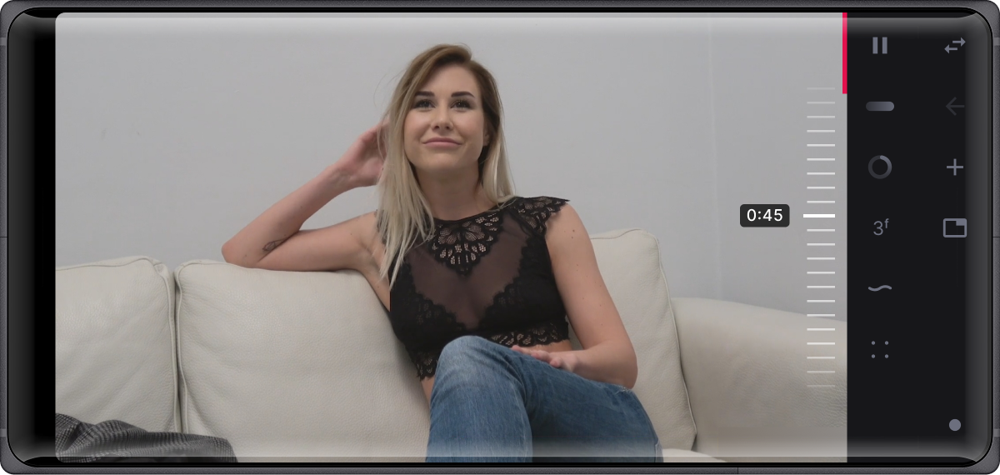

# Plllay

**A GeckoView-based Android browser with real video control.**

Plllay is not a thin wrapper around a web view. It ships a native scrubber drawn on a
Canvas, overlay control bars for fullscreen, and a page-side engine that drives video
playback — including players that do not like being touched.

<p align="center">
  
</p>

---

## Features

### Native scrubber

A vertical tape with one-second ticks and a marker, drawn on a `Canvas` — no DOM
elements layered over the player.

- 60 fps: position is interpolated between sparse state updates.
- One seek per gesture, not a stream: nothing is sent while the finger is moving.
- Seeks are expressed as a **fraction of duration**, so they never depend on which
  duration the app or the player reports.
- Fling inertia with decay: swipe up moves forward, velocity fades, a single final seek.
- Catch-up window: the marker does not snap back while the player is still seeking —
  including unbuffered ranges.
- A timecode pill appears only while interacting.
- The tape can sit on either edge; a nav-bar button flips it.

### Bars and overlays

| Mode | Bottom area |
|---|---|
| Portrait, normal | address bar + navigation |
| Portrait, fullscreen | control bar + navigation |
| Landscape, normal | navigation column |
| Landscape, fullscreen | control column + navigation column |
| "Hide everything" | video only; bars return via a floating button |

In landscape fullscreen the control bar becomes an overlay above the video: a gradient
scrim runs from transparent to 50% black, buttons are pinned to the top, and the restore
button sits exactly where the "hide" button was.

### Video control

- play / pause, ±10 seconds, mute, fullscreen, cover.
- Icons react instantly: the press is applied optimistically, and the player's
  confirmation is awaited for up to 1.2 s — no flicker.
- Cover (`object-fit: cover`) turns on when entering fullscreen or hidden mode, and the
  previous state is restored on exit.
- A 4 dp vertical progress indicator lives in its own layer at the right edge of the video.

### Working with real sites

- State is locked to a **single** video element: pages with several `<video>` tags no
  longer produce jumping positions or flapping flags.
- Video lookup walks **shadow DOM**, so players inside custom elements are found.
- If strict matching finds nothing, the largest visible video is used as a fallback, and
  ownership switches once an element reports a real duration.
- Three command levels: direct `<video>` calls, synthetic key events, and player APIs
  (JW Player, video.js, Plyr).
- Inactive tabs are suspended so they do not decode video in the background.

### Resilience

- A content-process crash triggers an automatic reload.
- Long-pressing the reload-scripts icon **recreates the tab session** — this recovers
  tabs that no longer respond to a plain reload.
- The extension port reconnects when the app returns from the background.
- Switching tabs asks the page to leave fullscreen first, so UI and player never disagree.
- Back in fullscreen exits fullscreen before navigating.

---

## Architecture

```
Android app
  MainActivity   GeckoRuntime, WebExtensionController, extension port
  MainFragment   layout, bars, overlays, ScrubberView, TabsViewModel
        ^ JSON over WebExtension.Port
        v
Bundled WebExtension (assets)
  background.js  routes messages by tab and frame
  content.js     forwards state and commands
  loader.js      downloads external files and caches them
        ^ CustomEvent / window API
        v
Page (sollor.js served from the server)
  command engine L1/L2/L3
  state pump
```

The app never drives the page directly: it talks to the extension, the extension talks to
the injected script, and the script talks to the player. That layering is what makes
players inside shadow DOM or iframes reachable at all.

---

## Gestures and buttons

| Action | Result |
|---|---|
| Drag along the scrubber strip | seek; the seek is applied when the finger settles |
| Quick fling | inertia, one seek at the end |
| Tap outside the strip | passes through to the page; only a 56 dp strip takes touches |
| Scrubber-side button | moves the tape to the other edge |
| "Hide everything" | hides bars and enables cover |
| Long-press "reload scripts" | recreates the tab with the same URL |
| Back while in fullscreen | leaves fullscreen |

---

## Requirements

- Android 7.0 (API 24) or newer
- arm64-v8a
- Building: JDK 17, Android SDK 34

## Building

```bash
git clone git@github.com:lacosta990/PLLLAY.git
cd PLLLAY
./gradlew :app:assembleDebug
```

Release builds are signed with `sollor.keystore`; passwords come from environment
variables `KEYSTORE_PASSWORD`, `KEY_ALIAS`, `KEY_PASSWORD`:

```bash
export KEYSTORE_PASSWORD='…'
export KEY_ALIAS='sollor'
export KEY_PASSWORD='…'
./gradlew :app:assembleRelease
```

## Versioning

- `versionCode` — an integer that must strictly increase with every release.
- `versionName` — the version shown to users.
- The bundled extension has its own version (`assets/extensions/sollor/manifest.json`).
- The injected `sollor.js` is versioned and served separately; the on-device cache is
  keyed by its URL.

## Limitations

- Control depends on the page: a closed shadow root or DRM can limit access to the video
  element.
- Fullscreen is initiated by the page; the app mirrors that state rather than forcing its own.
- Some vendor ROMs stop background processes aggressively, so background playback depends
  on system restrictions.

## License

Released under the MIT License. See [LICENSE](LICENSE).
